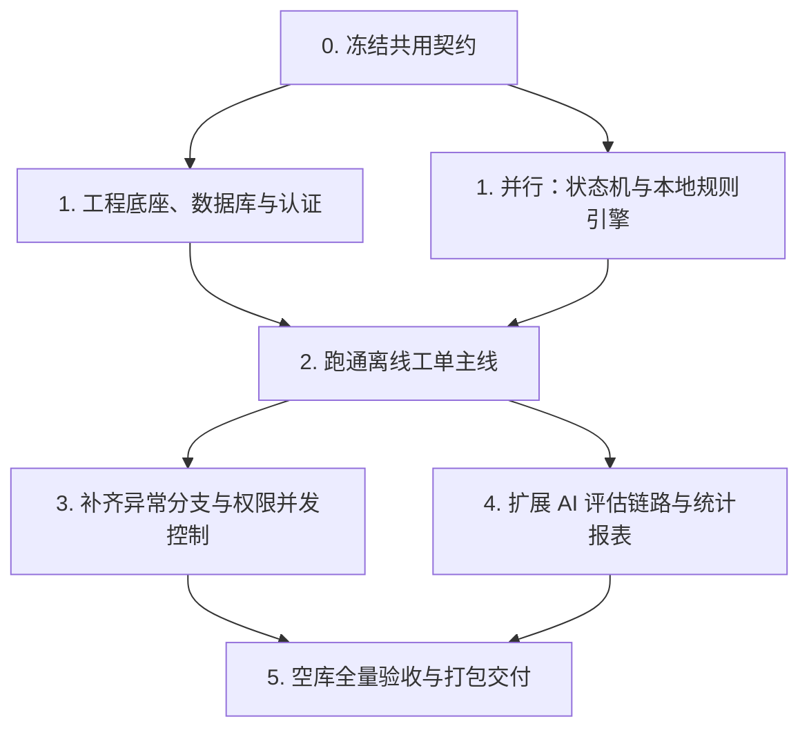

# T12｜实施计划与开发分工

**核心策略：先跑通离线工单主线，再扩展异常分支、外部模型与统计报表。** 第一阶段仅依托 MySQL、本地规则引擎与三类基础账号，将一张工单从正式上报完整推进至复盘归档。只要这条核心链路能在未配置 `AI_API_KEY` 的环境下稳定、可重复地跑通，后续的并发控制、模型对接与统计报表便具备了可靠的集成基座。

本文按模块依赖关系编排开发节奏与人员分工。开工前依据[需求规格](REQUIREMENTS.md)对齐业务边界，编码阶段严格遵循[系统设计方案](PLAN.md)与 [API 契约](API.md)；跨模块联调参照[操作手册](WORKFLOW.md)执行，测试证据则按[验收清单](ACCEPTANCE.md)归档。当前仓库处于设计阶段，以下各里程碑均待落地实施。

## 0. 开工前冻结共用约定

三位成员在编写业务代码前，先共同复核“上报、认领定级、开始处置、提请验证、复测确认、复盘归档”六大核心节点的必填字段、响应结构与推荐初值。后续若发生契约调整，须同步更新需求规格、API 契约与验收清单。开工前重点对齐以下四项跨模块接口：

| 协同事项 | 接口与边界约定 | 责任分工 |
| --- | --- | --- |
| 统一响应与认证上下文 | 统一 `Result<T>` 封装、HTTP 状态码与业务错误码映射、分页结构、UTC 时间格式；各业务模块统一从服务端安全上下文中获取当前登录用户 ID 与角色。 | A 负责提供基础组件，B / C 接入使用。 |
| 数据库建表与种子脚本 | 对齐 7 张表的主键、外键、状态枚举、乐观锁版本号及防重唯一键；确定先执行 `sql/schema.sql`、再导入 `sql/seed.sql` 的初始化顺序。 | 三人分别编写各自模块的表结构与样例数据，由 A 汇总整合为空库初始化脚本。 |
| 事件与评估服务对接 | 评估服务接收故障文本、关联资产与当前分级字典，返回标准评估结果对象。正式上报时，先在数据库写事务外完成评估计算，再由事件服务在同一写事务内写入工单、首次评估与初始状态日志。 | C 提供评估引擎与评估记录读写服务，B 负责上报及认领定级的事务编排。 |
| 事件与处置记录对接 | 日常追加处置记录为独立写入接口；而在“提请验证”时，修复结论记录必须随工单状态变更与状态日志在同一事务内原子提交或回滚。事件列表、详情与时间轴统一复用相同的可见范围校验逻辑。 | C 提供处置记录读写能力，B 负责状态流转事务与工单归属权限校验。 |

**阶段完成标志：** 三人能针对一张标准样例工单，完整列出从上报到归档各阶段所调用的接口路径、执行角色、目标状态及同步写入的数据表；B 与 C 可据以独立开展核心逻辑编码。

| 成员 | 主责模块与交付范围 | 负责数据表 |
| --- | --- | --- |
| 成员 A | 工程底座与多环境配置、JWT 认证与角色权限拦截、用户管理、资产与分级规则字典管理、打包与部署指导。 | `sys_user`、`biz_asset`、`biz_severity_rule` |
| 成员 B | 工单检索与全生命周期流转、水平越权防护、状态变更日志、多表事务与乐观锁并发控制；牵头跨模块联调。 | `biz_incident`、`biz_incident_status_log` |
| 成员 C | 本地规则与外部模型双引擎评估、应急处置记录管理、三大复盘统计报表及配套测试样本集。 | `biz_ai_assessment`、`biz_incident_action` |

每位成员对其主责模块的 Controller、Service、Mapper/XML、SQL 脚本及验收证据负全责，最终按此分工整理个人贡献表与答辩材料。

## 1. 搭建工程底座，并行开发独立核心逻辑

1. **成员 A（工程与数据库底座）：** 初始化 Java 21 + Spring Boot + Maven 工程，配置 MySQL 数据源、`dev`/`prod` 环境隔离及全局异常处理器。导入建表与种子脚本后，优先跑通 `GET /api/health` 接口以验证数据库连通性。
2. **成员 A（认证与基础主数据）：** 完成登录签发 JWT、当前用户信息查询与角色权限拦截器。预置上报人、评估师与管理员测试账号，导入至少一项已启用资产及完整的 `P0`–`P3` 分级规则，开放资产目录与分级规则的查询接口。
3. **成员 B / C（并行开发无外部依赖的核心逻辑）：** B 依据设计实现 `IncidentStateMachine` 状态机与合法跳转校验；C 优先实现不依赖外部网络的本地规则评分引擎，完成四档分数边界与 `RULE_FALLBACK` 输出结构的单元测试。这两部分工作无需等待数据库与 HTTP 层就绪即可先行推进。

**阶段完成标志：** 从空库执行初始化脚本后，健康检查返回 `UP`，三类角色账号均可正常登录，且具备相应权限的角色能够读取预置的资产目录与分级规则字典。

## 2. 联调跑通第一张离线工单

1. **成员 B + C（正式上报闭环）：** 上报人选择已启用资产并提交故障信息，调用本地规则引擎生成首次评估，验证工单主记录、首次 AI 评估记录与初始状态日志在同一事务内成功落库。随后通过工单列表与详情接口回查该工单，确认按角色与归属的数据可见范围过滤已正确生效。
2. **成员 B + C（认领定级与应急处置）：** 评估师调用 `/triage` 接口认领工单并确认最终等级，再调用 `/start` 接口进入处置状态；在调用 `/submit-verify` 提请验证时，将修复结论、验证方法与预期结果写入处置记录表，并与状态更新及状态日志在同一事务内提交。各接口均须严格校验角色、工单归属权与前置状态。
3. **成员 B（复测通过与归档，成员 A 并行补齐管理接口）：** 原上报人调用 `/verify` 确认验证通过并写入 `resolved_at`，最后由管理员调用 `/close` 完成归档，核对同一工单下的全套流转日志。与此同时，**成员 A 并行**补齐公开注册、修改密码、用户管理及资产/分级规则维护接口，并统一接入权限拦截体系。

**阶段完成标志：** 在未配置 `AI_API_KEY` 的环境下，通过 API 完整走通 `PENDING_TRIAGE → TRIAGED → IN_PROGRESS → PENDING_VERIFY → RESOLVED → CLOSED` 主线，数据库中准确生成 6 条状态变更日志，且可使用固定测试脚本反复重现。

## 3. 补齐异常分支、权限隔离与并发控制

1. **成员 B（异常流转分支）：** 实现原上报人撤回（`CANCELLED`）、评估师驳回（`REJECTED`）以及验证未通过退回重修（`PENDING_VERIFY → IN_PROGRESS`）。验证终态工单禁止继续流转，且验证打回后仍由原处理人继续跟进。
2. **成员 C + B（处置记录与时间轴）：** 补齐处置过程中的独立追加记录接口（`POST /api/incidents/{id}/actions`）与完整时间轴查询接口（`GET /api/incidents/{id}/timeline`）；通过时间轴核验撤回、驳回、验证打回的原因展示，以及多轮提请验证的时序稳定性。
3. **成员 A + B（越权防护、并发与事务回滚）：** 使用两名上报人（`R1/R2`）和两名评估师（`A1/A2`）交叉验证各角色的读写边界与水平越权拦截。编写集成测试验证同分钟重复上报拦截、双评估师并发抢单、认领与撤回并发冲突，并通过故障注入模拟状态日志写入异常，确认工单状态与关联记录能够完整回滚。

**阶段完成标志：** 每条异常分支均具备独立测试样例；角色越权、水平越权、非法状态跳转与并发版本冲突均返回契约规定的错误码，且任何失败请求均不会写入脏状态或多余日志。

## 4. 扩展 AI 评估能力与统计报表（可与阶段 3 并行）

1. **成员 C + B（完善评估入口与定级快照）：** C 复用统一评估引擎支持上报前预评估（`/api/ai/preview-assess`）与在途工单深度复评（`/api/incidents/{id}/ai-assess`）；B 在认领定级逻辑中支持指定本单历史评估作为参考。验证预览绝不落库、复评仅追加历史记录，且定级后触发的复评不会篡改已锁定的最终等级与定级快照。
2. **成员 C（对接外部大模型与降级兜底）：** 接入兼容 OpenAI 协议的模型调用客户端，配置连接/读取超时与结构化 JSON 输出校验。分别针对正常响应、网络/超时失败、字段缺失或分值越界等场景验证 `LLM_API` 与 `RULE_FALLBACK` 标记，确保外部模型异常时主业务流程无感降级、照常流转。
3. **成员 C（实现三大统计报表）：** 待工单状态流转、`resolved_at` 写入及定级快照逻辑稳定后，按固定测试样本实现并核对“等级分布统计”、“高风险资产 Top 5”与“AI 定级一致率与耗时”三个报表接口，覆盖空时间窗口边界测试。

**阶段完成标志：** 无论是否配置外部模型凭据，均可走通完整工单生命周期；在实现报表前，B 与 C 先通过一张“人工最终等级与 AI 建议等级不一致”的工单核准定级快照字段，确保管理员报表各项指标与固定样本手工计算结果完全一致。

## 5. 空库全量验收与打包交付

1. **三人联合回归：** 对照 [API 契约](API.md)逐一核对全部 32 个接口的路径、权限、入参校验与响应格式，完整执行[验收清单](ACCEPTANCE.md)。按“离线主线 → 异常与越权分支 → 并发与回滚 → 模型降级 → 报表复算”的顺序留存测试证据。
2. **成员 A 负责打包，成员 B / C 独立复验：** 从干净的 Git 检出目录执行 `mvn clean verify`，连接全新初始化的独立 MySQL 数据库，启动 `target/incident-triage-hub.jar`。验证健康检查、账号登录及至少一张工单从上报到归档的完整闭环。
3. **整理最终交付物：** 汇总提交可执行 JAR 包、数据库建表与种子脚本、环境变量配置示例、生产环境管理员初始化说明、Knife4j 接口文档、完整验收记录及三人贡献度说明表。

**阶段完成标志：** 未参与编码的第三方人员仅依据仓库文档，即可在空库环境下完成服务构建与启动、登录三类角色账号、跑通主线业务流程，并复核全部 32 个接口的验收结果。
