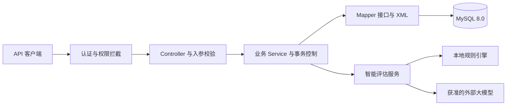

# T12｜系统设计方案

**状态：拟实施。** 本文阐述如何将[需求规格](REQUIREMENTS.md)落地为工程实现，涵盖应用分层架构、7 张核心数据表、事务与并发边界、AI 双引擎适配、SQL 检索聚合及运行环境配置。具体业务规则以需求规格为准；全部 32 个接口的路由、参数与错误码映射统一在 [API 契约](API.md)中维护。

## 1. 应用边界和模块

工程技术基线采用 **Java 21 + Spring Boot 3.3.x + Maven**（具体小版本在初始化工程时固化至 `pom.xml`），关系型数据库采用 **MySQL 8.0**。持久层使用 **MyBatis-Plus 3.5.x**：简单单表条件检索使用 Wrapper，多表关联、动态条件过滤与分组聚合统计统一使用 Mapper XML 编写。认证与安全采用 `jjwt 0.12.x` 与 `BCryptPasswordEncoder`；入参校验使用 Jakarta Validation；开发环境通过 Knife4j 自动生成 OpenAPI 交互文档。外部大模型适配层基于 Spring `RestClient` 调用兼容 OpenAI 协议的 HTTP 接口。

| 包路径或模块 | 核心职责与边界约束 |
| --- | --- |
| `com.g01.incident.common` | 统一响应封装 `Result<T>`、业务错误码枚举、工单状态/角色/故障等级枚举及通用分页响应对象。 |
| `config` | MyBatis-Plus 分页与乐观锁插件、Spring MVC 拦截器注册、Knife4j 文档配置、外部模型 `RestClient` 及多环境参数绑定。 |
| `security` | `JwtTokenProvider`、`AuthInterceptor`、`@RequireRole` 权限注解及线程级请求身份上下文（请求结束时无论成功或异常均必须在 `afterCompletion` 中清理线程上下文）。 |
| `exception` | `BusinessException` 与全局异常处理器 `GlobalExceptionHandler`，将参数校验异常、业务冲突、数据库异常及未知系统错误统一映射为标准 API 响应。 |
| `controller` | 接收请求 DTO、触发 `@Valid` 校验、声明 `@RequireRole` 角色准入并封装 `Result<T>`；严禁在 Controller 层直接调用 Mapper。 |
| `service` | 承载主数据、账号、工单生命周期、AI 评估、处置记录与统计报表的核心业务逻辑；统一在此校验工单归属可见性、状态机合法流转与数据库事务边界。 |
| `mapper` / `model` | 维护 Mapper 接口、XML SQL 映射及数据模型；严格分离数据库实体（Entity）、请求入参（DTO）与响应视图（VO），密码哈希等敏感列绝不进入 VO。 |

## 2. 数据模型：7 张表

所有时间列在服务端统一转换为 UTC 时间写入，并采用支持微秒精度的日期时间类型（如 `DATETIME(6)`），以确保恢复耗时计算与同秒内时间轴排序的一致性。业务表主键均采用数据库自增正整数。用户账号与业务资产通过状态字段控制启停，工单数据不提供物理删除入口；表间外键严禁配置级联删除（`ON DELETE CASCADE`），防止误删历史审计轨迹。面向用户展示的工单号与自增主键解耦并建立唯一索引（格式示例：`INC20261120-8K4NR`）；若生成工单号时发生随机段碰撞，可在服务端有限次重试，不得将其误判为用户重复上报。

| 表名 | 核心字段 | 索引设计与完整性约束 |
| --- | --- | --- |
| `sys_user` | `id`, `username`, `password_hash`, `real_name`, `role`, `department`, `phone`, `status`, `token_version`, `created_at`, `updated_at` | `username` 建立唯一索引；`role` 与 `status` 用于管理员列表筛选及“最后一名启用管理员”保护校验。`token_version` 初始为 `0`，修改密码或停用账号时原子递增。 |
| `biz_asset` | `id`, `asset_code`, `asset_name`, `category`, `criticality`, `owner_name`, `sla_response_min`, `status`, `created_at`, `updated_at` | `asset_code` 唯一且创建后不可变更；重要度 `criticality` 取值 1–5，响应时限 `sla_response_min` 为正整数；支持按类别、启用状态及编码/名称关键词检索。 |
| `biz_severity_rule` | `id`, `severity_code`, `severity_name`, `score_min`, `score_max`, `sla_resolve_hours`, `ai_prompt_hint`, `updated_at` | `severity_code`（`P0`–`P3`）唯一；单行约束 `0 <= score_min <= score_max <= 100` 且 `sla_resolve_hours > 0`；四档区间是否连续无重叠地完整覆盖 0–100，由服务层在事务内锁定整表后统一校验。 |
| `biz_incident` | `id`, `incident_no`, `title`, `description`, `asset_id`, `reporter_id`, `assignee_id`, `ai_severity`, `impact_score`, `final_severity`, `reference_assessment_id`, `triage_reason`, `status`, `dedup_key`, `version`, `occurred_at`, `created_at`, `resolved_at`, `updated_at` | `incident_no` 与 `dedup_key` 分别建立唯一索引；`reporter_id`、`assignee_id`、`asset_id` 为外键。建单初始时 `assignee_id`、`final_severity`、`reference_assessment_id`、`resolved_at` 均为空；认领定级时在事务内校验 `reference_assessment_id` 必须归属于当前工单。 |
| `biz_ai_assessment` | `id`, `incident_id`, `engine_type`, `model_name`, `suggested_severity`, `impact_score`, `affected_scope`, `root_cause_guess`, `mitigation_steps`, `is_adopted`, `latency_ms`, `created_at` | `incident_id` 为外键；建立复合索引 `(incident_id, created_at, id)` 以支撑按工单高效分页查询评估历史。按创建时间与 ID 升序排列的第一条记录即为该工单的首次评估。 |
| `biz_incident_action` | `id`, `incident_id`, `operator_id`, `action_type`, `action_detail`, `cost_minutes`, `verify_method`, `expected_result`, `created_at` | `incident_id` 与 `operator_id` 为外键；复合索引 `(incident_id, created_at, id)` 支撑时间轴聚合查询；日常追加处置记录时 `verify_method` 与 `expected_result` 可为空。 |
| `biz_incident_status_log` | `id`, `incident_id`, `from_status`, `to_status`, `operator_id`, `remark`, `created_at` | `incident_id` 与 `operator_id` 为外键；复合索引 `(incident_id, created_at, id)` 支撑按单回溯流转轨迹；建单初始日志的 `from_status` 为 `NULL`。 |

工单主表 `biz_incident` 的二级索引围绕三类角色的高频检索场景构建：`(reporter_id, created_at, id)`、`(assignee_id, created_at, id)`、`(status, created_at, id)`，同时配置基于 `(asset_id, created_at)` 与 `(created_at, final_severity, status)` 的索引以支撑统计报表。代码落地后通过 `EXPLAIN` 核验核心 SQL 的索引命中与排序计划；在未明确生产压测规模前，不作硬编码的绝对耗时承诺。

`sql/schema.sql` 面向空库创建全部表结构、外键约束与索引。`sql/seed.sql` 仅用于隔离的开发与演示环境：核心业务表预置约 12–15 条覆盖各状态分支的典型工单样例，分级规则表预置完整的 `P0`–`P3` 四档配置；关联的评估记录、处置记录与状态日志严格按照各样例工单的实际流转路径生成，确保外键引用与时间先后逻辑自洽。生产环境部署时仅执行 `schema.sql`、装载初始 `P0`–`P3` 字典并通过安全引导机制创建首个管理员账号，严禁将开发演示账号带入生产环境。

## 3. 鉴权和审计实现

1. **动态令牌校验与即时失效：** 除健康检查、公开注册与登录接口外，`AuthInterceptor` 对所有请求校验 JWT 签名、过期时间及用户 ID，并实时查询数据库（或一致性缓存）核对当前账号的启用状态、最新角色与 `token_version`。JWT 载荷中的角色仅作签发快照参考，实际鉴权以服务端当前角色为准。一旦账号修改密码或被管理员停用，`token_version` 递增或状态变更使既有令牌立即失效，无需等待 JWT 自然过期；账号重新启用后亦不恢复旧令牌，必须重新登录。
2. **双层权限防线（RBAC + 数据归属）：** Controller 层通过 `@RequireRole` 拦截不具备对应角色权限的请求（返回 `40301`）；Service 层对工单列表、详情、时间轴、深度复评及所有状态流转接口复用统一的数据可见性校验逻辑（越权访问他人或非本职责范围的工单时返回 `40302`）。写入操作进一步校验操作者是否为原上报人、当前处理人或管理员。所有操作者身份均取自服务端认证上下文，MyBatis Mapper 严格使用 `#{} ` 参数绑定以杜绝 SQL 注入。
3. **关键管理操作的并发保护与审计：** 在停用管理员账号或将其降级为其他角色前，必须在事务内对当前所有处于启用状态的管理员记录加悲观锁（`SELECT ... FOR UPDATE`）并重新计数，防止两个并发请求同时移除最后两名管理员而导致系统无人可管。更新分级规则的分数边界时，同样在事务内锁定全部四档记录后执行连续性与无重叠校验。管理员执行的用户角色/状态变更、资产维护与分级规则修改，以及工单的每一次状态流转，均必须记录包含操作者、目标对象、变更前后值、时间戳与请求 ID 的审计信息（其中工单状态日志直接写入 `biz_incident_status_log` 并与业务写入共享同一数据库事务）。
4. **日志脱敏与安全红线：** 明文密码、密码哈希摘要、完整 JWT、外部模型 API 密钥以及发送给外部模型的原始请求/响应报文，严禁写入任何应用日志。异常响应仅向客户端返回安全的业务提示与 `requestId`；服务端日志通过 `requestId` 串联请求上下文、错误分类与模型降级原因。

## 4. 状态机、写入顺序和并发

`IncidentStateMachine` 集中维护[工单生命周期](REQUIREMENTS.md#4-工单生命周期)中定义的全部合法有向边。Service 层在执行任何写入前依次校验操作者角色、工单归属权与前置状态，并基于客户端传入的 `version` 执行乐观锁条件更新。凡涉及跨事务外部调用（如 AI 评估）的操作，在真正开启写事务落库前必须重新校验工单最新状态；任何失败或被拦截的操作均不得写入状态变更日志。

| 业务场景 | 事务编排与并发控制边界 |
| --- | --- |
| 正式上报 (`POST /api/incidents`) | 请求进入时立即按服务端 UTC 时间截取当前自然分钟，由“上报人 ID + 资产 ID + 去首尾空白后的标题 + UTC 分钟时间戳”生成带唯一索引的防重摘要 `dedup_key`。先校验基础入参并在数据库写事务外完成首次 AI/规则评估；随后开启写事务，锁定并重查关联资产仍处于启用状态，在同一事务内依次插入工单主记录、首次评估记录与 `NULL → PENDING_TRIAGE` 初始状态日志。捕获唯一键冲突时，仅当冲突约束为 `dedup_key` 时才映射为重复上报（`40902`），严禁将工单号随机段碰撞等其他唯一键异常误报为重复提单。 |
| 认领并定级 (`POST /api/incidents/{id}/triage`) | 采用乐观锁条件更新，SQL `WHERE` 子句须同时匹配 `id`、`status = 'PENDING_TRIAGE'`、`assignee_id IS NULL` 及客户端传入的 `version`；原子更新当前处理人、人工最终等级、参考评估 ID、定级快照（建议等级与影响分）、定级理由并将 `version + 1`。在同一事务内更新所引用评估记录的采纳标记（`is_adopted`）并插入 `PENDING_TRIAGE → TRIAGED` 状态日志。 |
| 补充描述、撤回、驳回与常规流转 | 条件更新语句均携带前置 `status` 与 `version`（撤回与驳回还须校验 `assignee_id IS NULL`）。若受影响行数为 `0`，在当前读下重新核查该工单的最新状态与版本，并严格按照 [API 错误规则](API.md#7-错误响应与客户端恢复)区分返回 `40901`（状态已不支持该操作）或 `40903`（状态仍允许但版本已过期/抢单失利），绝不盲目自动重试。 |
| 提请验证与复测确认 | 提请验证时，工单状态更新（`IN_PROGRESS → PENDING_VERIFY`）、新增 `REPAIR` 类型处置记录（含修复结论、验证方法与预期结果）以及状态变更日志必须在同一事务内原子提交。原上报人复测通过时，仅在该次流转（`PENDING_VERIFY → RESOLVED`）中写入 `resolved_at`；复测未通过时退回 `IN_PROGRESS`，保持 `resolved_at` 为 `NULL`，并将未通过原因完整写入状态日志。 |
| 独立追加处置记录 (`POST /api/incidents/{id}/actions`) | 在短事务内对目标工单行加锁（或条件校验）并确认其仍处于 `IN_PROGRESS` 且归属当前处理人，防止在工单已提请验证或状态变更后仍混入滞后的处置记录；独立追加处置记录不递增工单的乐观锁 `version`。 |
| 在途工单深度复评 (`POST /api/incidents/{id}/ai-assess`) | 调用模型前先读取并校验工单是否处于可复评状态、操作者是否具备权限，并记录当前 `version`；随后在数据库事务外执行模型调用或规则计算。拿到评估结果后开启短事务，锁定工单行并重查当前操作者权限、工单状态与 `version`：若模型调用期间工单已被修改或流转，则直接丢弃本次过期的评估结果并返回冲突提示；若校验通过，仅向 `biz_ai_assessment` 插入新评估记录，绝不覆盖工单主表上的定级快照。 |

所有写事务均须配置异常完整回滚（如 `@Transactional(rollbackFor = Exception.class)`）。当条件更新受影响行数为 `0` 时，必须立即抛出业务异常以触发回滚，严禁将其视作幂等成功；冲突原因判定必须基于最新数据库当前读（或在失败事务结束后重新查询），避免受可重复读（RR）隔离级别下的旧事务快照误导。对于已通过前置权限校验但因并发竞争失利的请求，若工单仍处于可操作状态仅版本过期（或双评估师在同一待分诊版本上抢单失利）则返回 `40903`，若工单已流转至不允许该操作的状态则返回 `40901`。事务回滚能力在验收阶段通过故障注入（模拟插入状态日志时抛出异常）进行专项验证。

## 5. 评估服务与报表查询

### 智能评估与规则降级链路

调用外部大模型前，先对故障文本做合规检查与清理，仅拼接[需求允许外发的字段](REQUIREMENTS.md#5-ai-评估处置记录和时间轴)（标题、故障描述、资产类别/重要度及当前四档分级标准）。请求体要求模型返回具有严格 schema 约束的 JSON 对象；收到响应后依次校验必填文本非空、影响分为 0–100 整数、建议等级与当前分级字典的分数区间完全吻合。单次评估请求最多发起一次外部 HTTP 调用，不作耗时重试，且连接超时与读取超时均支持配置。一旦发生未配置凭据、网络异常、超时、JSON 解析失败或分数与等级矛盾，立即无缝切换至本地规则引擎（使用同一套 `P0`–`P3` 分级字典），并在落库记录中如实标记引擎类型（`LLM_API` 或 `RULE_FALLBACK`）、实际耗时与模型名称。

本地规则引擎评分建议初值：
- **资产重要度基础分：** 资产 `criticality` 1–5 级分别对应基础分 `0`、`10`、`20`、`30`、`40`。
- **故障信号词加分：** 按故障影响程度划分为三档加分——轻度异常加 `15` 分（如“偶发超时”、“响应变慢”）、核心功能受损加 `35` 分（如“核心接口超时”、“部分不可用”、“登录失败”）、全局中断或高危故障加 `60` 分（如“全面不可用”、“全校断网”、“数据损坏”、“宕机”）。同一文本命中多个关键词时仅取最高一档加分，未命中任何关键词时加 `0` 分。
- **总分截断与等级映射：** 将“资产基础分 + 关键词最高档加分”限制在 `0`–`100` 闭区间内，再对照当前数据库中的 `biz_severity_rule` 四档区间映射出 `suggestedSeverity`。生成的 `affectedScope`、`rootCauseGuess` 与 `mitigationSteps` 提供可供评估师人工核验的排查线索，线索不足时明确标注“待确认”，绝不捏造受影响用户数量等虚假数据。上述关键词表与分值作为工程实现起点，由成员 C 在联调前固化至配置与测试用例中。

### 列表检索、详情组装与统计聚合

- **事件列表与详情：** 分页查询 SQL 先在最内层注入当前角色的数据可见范围条件，再叠加客户端传入的多维筛选条件。单件工单详情通过一条 `LEFT JOIN` SQL 一次性查出工单主字段、关联资产摘要及上报人/处理人的基本显示信息（ID 与姓名）；通过归属权校验后，再按 `incident_id` 分页查询 `biz_ai_assessment` 评估历史，从根源上杜绝 N+1 查询。
- **时间轴合并查询：** 在 SQL 层通过 `UNION ALL` 将 `biz_incident_status_log` 与 `biz_incident_action` 两表关于该工单的记录合并，按 `created_at ASC, entry_order ASC, id ASC` 统一排序并分页，同时关联 `sys_user` 一次性带出操作者显示姓名，不在 Java 内存中做全量拉取分页或逐行回表查人名。
- **三大复盘报表：**
  - **等级分布 (`severity-summary`)：** 对过滤时间窗内 `final_severity IS NOT NULL` 的工单按 `(final_severity, status)` 执行 `GROUP BY`，计算工单数与快照 `impact_score` 的平均值。
  - **高风险资产 (`high-risk-assets`)：** 关联 `biz_asset` 与 `biz_incident`，过滤掉 `REJECTED` 与 `CANCELLED` 异常终态，按每个资产的故障工单总数降序、`asset_id` 升序取 Top 5；恢复耗时均值仅通过条件聚合 `AVG(CASE WHEN status IN ('RESOLVED', 'CLOSED') ... THEN TIMESTAMPDIFF(SECOND, occurred_at, resolved_at) END)` 计算，确保未解决工单不会拉低平均恢复耗时。
  - **AI 一致率 (`ai-adoption-rate`)：** 采用两组独立聚合（或子查询）分别统计工单维度的定级一致率（分母为 `final_severity IS NOT NULL` 的工单数，分子为 `final_severity = ai_severity` 的工单数）与评估记录维度的总次数及平均耗时（`AVG(latency_ms)`），防止一张工单存在多条复评记录时放大定级一致率的分母。所有指标精度与空值语义严格对齐[统计需求](REQUIREMENTS.md#6-复盘与报表)与 [API 契约](API.md#6-统计3-个)。

## 6. 配置、运行和交付约束

| 环境变量 / 配置项 | 用途与安全约束 |
| --- | --- |
| `DB_URL`、`DB_USERNAME`、`DB_PASSWORD` | MySQL 数据库连接信息，统一通过外部环境变量注入；`DB_URL` 为标准 JDBC URL（建议显式指定 `serverTimezone=UTC`）。开发环境与生产环境数据库严格物理隔离。 |
| `JWT_SECRET`、`JWT_EXPIRE_HOURS` | JWT 签名密钥须使用至少 32 字节的高熵随机字节并经 Base64 编码，令牌默认有效期建议设为 `8` 小时；生产环境严禁使用代码库中的示例占位密钥。 |
| `AI_BASE_URL`、`AI_API_KEY`、`AI_MODEL` | 三项配齐且模型服务获准调用时启用外部大模型评估；任一未配置时默认走本地规则引擎。`AI_BASE_URL` 为兼容 OpenAI 协议的接口基地址（按供应商要求包含版本路径，如 `https://.../v1`）。 |
| `AI_CONNECT_TIMEOUT_MS`、`AI_READ_TIMEOUT_MS` | 外部模型 HTTP 连接与读取超时时间（正整数毫秒）。推荐初值分别为 `2000` ms 与 `5000` ms，可在实测后按需调整，但不得影响离线验收表现。 |
| `SPRING_PROFILES_ACTIVE`、`SERVER_PORT` | 环境 Profile（本地开发与联调使用 `dev`，生产部署使用 `prod`）及 HTTP 监听端口（默认 `8080`）。`dev` 环境启用 Knife4j 文档页面，`prod` 环境强制关闭在线调试端点与详细 SQL 打印。 |

健康检查接口 `GET /api/health` 主动执行轻量级数据库探活查询（如 `SELECT 1`），正常时返回 HTTP `200` 与 `UP`，数据库不可达时返回 HTTP `503` 与 `DOWN`；响应体严禁暴露数据库地址、账号凭据或底层异常堆栈。Maven 构建固定产出可执行胖包 `target/incident-triage-hub.jar`。仓库中的配置文件仅保留变量名与安全占位符，真实密钥均由运行环境注入。服务启动步骤详见[操作手册](WORKFLOW.md)，回归测试与交付物核验详见[验收清单](ACCEPTANCE.md)。

## 7. 课程要求对照

本节仅映射原课题设计方案中已明确标注的课程条款编号（在无原始评分细则原文时不额外杜撰条款表述）：
- **条款 4.1 / 4.3 / 4.9：** 对应工程规范分层、多环境配置隔离与可复现打包交付；
- **条款 4.2：** 对应 7 张业务与系统表的关系模型、外键及索引设计；
- **条款 4.4：** 对应完整覆盖业务闭环的 32 个 RESTful HTTP 接口；
- **条款 4.5：** 对应 BCrypt 密码存储、JWT 认证、RBAC 角色控制及工单归属权限校验；
- **条款 4.6：** 对应工单状态机流转、多表原子事务、防重唯一索引与乐观锁并发抢单控制；
- **条款 4.7：** 对应多表 `JOIN` 查询、数据库侧动态分页及 `GROUP BY` 统计报表聚合；
- **条款 4.8：** 对应入参校验、统一错误码映射与日志/响应敏感信息脱敏。

三位团队成员的代码模块分工与答辩验收证据详见[实施计划](IMPLEMENTATION.md)与[验收清单](ACCEPTANCE.md)。
