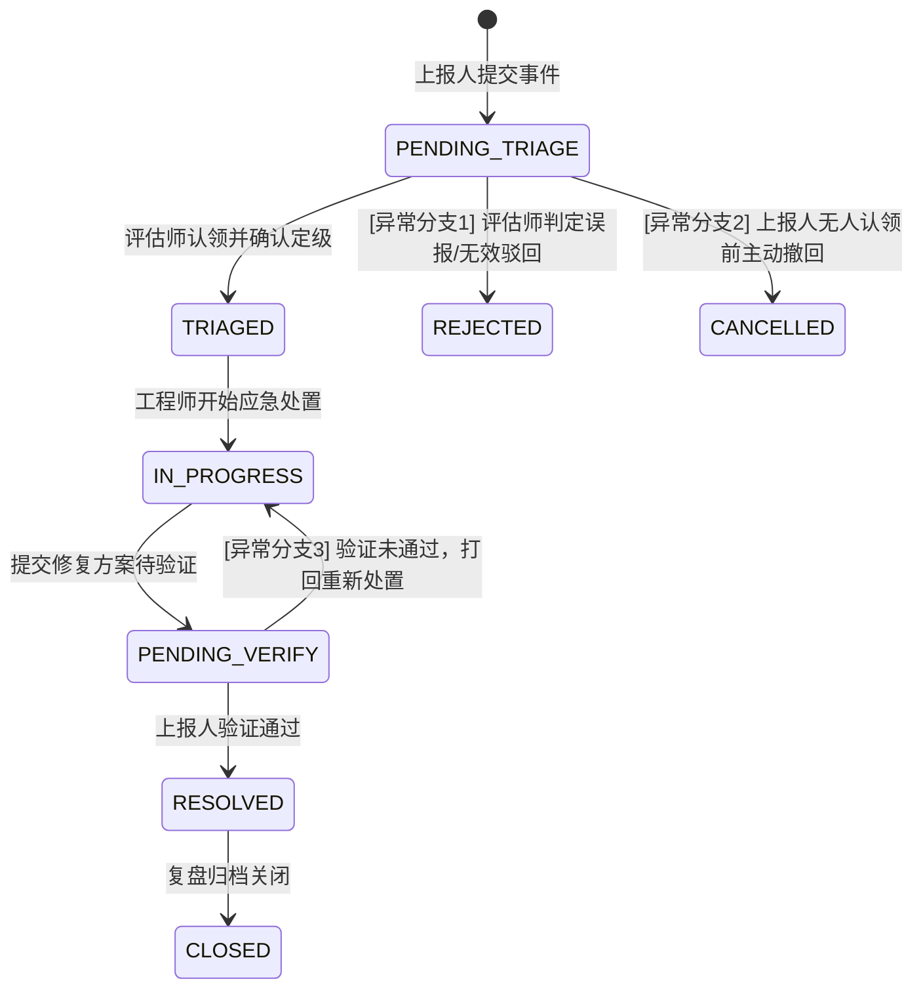

# T12 【AI】事件分级与影响评估助手 — 系统设计方案

## 1. 项目定位与核心业务场景
本项目面向高校信息中心或企业 IT 运维部门，构建一套集**事件上报、AI 智能分级与影响面评估、应急响应流转、复盘统计**于一体的后端服务系统。

当发生服务器宕机、核心业务接口超时、网络中断或安全告警时，上报人提交事件现象与关联资产；系统通过 **AI 评估引擎（大模型 API + 本地规则引擎降级兜底）**，结合资产重要度自动输出建议等级（`P0`~`P3`）、影响评分（`0~100`）、预估波及范围与应急处置建议；随后工单进入受控的 6 态主流程与异常分支闭环，全链路记录状态变更审计日志。

---

## 2. 技术栈与分层工程规范 (对应要求 4.1, 4.3, 4.9)

### 2.1 技术选型
* **核心框架**：Java 21 + Spring Boot 3.3.x + Maven
* **持久层**：MySQL 8.0 + MyBatis-Plus 3.5.x（单表用 Wrapper，多表联查与聚合统计使用 Mapper XML）
* **安全与认证**：JWT (`io.jsonwebtoken:jjwt 0.12.x`) + `BCryptPasswordEncoder` + 自定义 `HandlerInterceptor`
* **文档与校验**：Knife4j (`knife4j-openapi3-jakarta-spring-boot-starter`) + Jakarta Validation (`@Valid`)
* **AI 集成方案**：使用 Spring Boot 3 原生 `RestClient` 调用兼容 OpenAI 协议的大模型接口（如 DeepSeek / 通义千问）；当未配置 API Key 或网络超时，自动平滑降级至本地关键词权重规则引擎，保证 `java -jar` 离线评测与答辩演示 100% 成功。

### 2.2 标准包结构 (`com.g01.incident`)
```text
com.g01.incident
├── common          // 统一响应 Result<T>、错误码枚举 ErrorCode、业务枚举 (RoleEnum, IncidentStatusEnum, SeverityEnum)
├── config          // WebMvcConfig(拦截器与白名单)、MyBatisPlusConfig(分页+乐观锁插件)、Knife4jConfig
├── security        // JwtTokenProvider、AuthInterceptor、@RequireRole权限注解、UserContext(ThreadLocal存储当前用户)
├── exception       // BusinessException、GlobalExceptionHandler(区分业务异常、校验异常与系统异常)
├── controller      // 仅负责参数接收(@Valid DTO)、调用Service、封装Result<VO>返回，不含业务逻辑
├── service         // Service接口与impl实现类（状态机校验、事务控制、AI评估调度、水平越权校验）
├── mapper          // Mapper接口及 src/main/resources/mapper/*.xml
└── model
    ├── entity      // 数据库表 1:1 映射实体
    ├── dto         // 请求入参对象（含 @NotBlank/@NotNull 等校验注解，屏蔽敏感字段 toString）
    └── vo          // 响应视图对象（剔除 password_hash 等敏感列，承载多表关联与统计结果）
```

### 2.3 配置外置与多环境交付
* `application.yml` 通过环境变量注入核心配置并提供本地开发安全默认值，杜绝硬编码：
  * 数据库：`DB_URL`、`DB_USERNAME`、`DB_PASSWORD`
  * 安全认证：`JWT_SECRET`、`JWT_EXPIRE_HOURS`
  * AI 服务：`AI_BASE_URL`、`AI_API_KEY`、`AI_MODEL`
* 多环境隔离：`application-dev.yml`（开启 Knife4j 文档与 SQL 调试日志）、`application-prod.yml`（关闭调试输出、规范 INFO 级文件日志），启动时通过 `--spring.profiles.active=prod` 或环境变量 `SPRING_PROFILES_ACTIVE` 切换。
* 容器探针：提供免鉴权接口 `GET /api/health`，检测应用存活及数据库连通性并返回 `UP` 状态。

---

## 3. 角色设计与权限越权防护 (对应要求 4.5)

系统设立 **3 种角色**，通过拦截器解析 JWT 写入 `UserContext`，配合 `@RequireRole` 注解实现接口级鉴权（RBAC）：

| 角色编码 | 角色名称 | 核心职责与接口权限 | 防水平越权控制点（答辩必查） |
| :--- | :--- | :--- | :--- |
| `REPORTER` | 事件上报人（学生/普通员工） | 提交事件单、上报前触发 AI 预评估、查看/补充本人提交的事件、撤回待分诊事件、对已修复事件执行验证通过或打回 | 访问 `GET/PUT /api/incidents/{id}`、撤回、验证接口时，Service 层强制校验 `incident.getReporterId().equals(UserContext.getUserId())`；修改 URL 中的 ID 访问他人单据直接抛出 `403 FORBIDDEN` |
| `ANALYST` | 应急评估师/处置工程师 | 查看待分诊事件池、并发认领（抢单）事件、触发深度 AI 影响评估、确认最终定级、填写处置记录、推进处置流转 | 推进处置进度（开始处置、提交验证）时，强制校验 `incident.getAssigneeId().equals(UserContext.getUserId())`，非当前认领工程师无权篡改他人负责的工单 |
| `ADMIN` | 系统管理员/运维主管 | 用户管理与角色分配、维护受影响业务系统/资产库（主数据）、维护分级标准字典、审批驳回单、查看全局统计报表 | 具备全局管理与审计视角，关键配置变更记录操作人日志 |

---

## 4. 数据库设计：7 张表结构与索引规划 (对应要求 4.2)

满足“不少于 6 张表”要求，共设计 **7 张表**，覆盖用户、两类主数据、核心业务单据、AI 评估扩展、处理记录、状态日志。`schema.sql` 与 `seed.sql`（每张主要表预置 12~15 条真实业务数据）可在空库一键执行。

1. **`sys_user`（用户表）**
   * 主要字段：`id` (PK), `username` (VARCHAR, **UK唯一索引**), `password_hash` (BCrypt密文), `real_name`, `role` (`REPORTER`/`ANALYST`/`ADMIN`, **普通索引**), `department`, `phone`, `status` (1启用/0禁用), `created_at`, `updated_at`
2. **`biz_asset`（业务系统与IT资产表 —— 主数据表 1）**
   * 主要字段：`id` (PK), `asset_code` (**UK唯一索引**), `asset_name`, `category` (核心教学/财务交易/网络基础设施/门户网站), `criticality` (重要度 1~5 星，供 AI 计算影响权重), `owner_name`, `sla_response_min` (SLA响应时限), `status`, `created_at`
3. **`biz_severity_rule`（事件分级标准字典表 —— 主数据表 2）**
   * 主要字段：`id` (PK), `severity_code` (`P0`/`P1`/`P2`/`P3`, **UK唯一索引**), `severity_name` (特别重大/重大/较大/一般), `score_min`, `score_max`, `sla_resolve_hours`, `ai_prompt_hint` (注入给 AI 的定级判定准则), `updated_at`
4. **`biz_incident`（事件主单据表 —— 业务单据表）**
   * 主要字段：`id` (PK), `incident_no` (单号如 `INC20261118001`, **UK唯一索引**), `title`, `description`, `asset_id` (**FK** -> `biz_asset.id`, **索引**), `reporter_id` (**FK** -> `sys_user.id`, **索引**), `assignee_id` (**FK** -> `sys_user.id`, 可空, **索引**), `ai_severity` (`P0`~`P3`), `final_severity` (`P0`~`P3`, **索引**), `impact_score` (0~100), `status` (状态枚举, **索引**), `dedup_key` (防重复提交幂等摘要, **UK唯一索引**), `version` (乐观锁版本号, 默认0), `occurred_at`, `resolved_at`, `created_at` (**索引**)
5. **`biz_ai_assessment`（AI 分级与影响评估记录表 —— AI 特色业务表）**
   * 主要字段：`id` (PK), `incident_id` (**FK** -> `biz_incident.id`, **索引**), `engine_type` (`LLM_API` / `RULE_FALLBACK`), `model_name`, `suggested_severity` (`P0`~`P3`), `impact_score`, `affected_scope` (预估影响范围描述), `root_cause_guess` (AI 初步根因推测), `mitigation_steps` (AI 建议应急措施), `is_adopted` (评估师是否采纳: 0/1), `latency_ms`, `created_at`
6. **`biz_incident_action`（事件应急处置记录表 —— 处理记录表）**
   * 主要字段：`id` (PK), `incident_id` (**FK** -> `biz_incident.id`, **索引**), `operator_id` (**FK** -> `sys_user.id`, **索引**), `action_type` (`DIAGNOSE`排查 / `MITIGATE`止损 / `REPAIR`修复 / `NOTIFY`通报), `action_detail`, `cost_minutes`, `created_at`
7. **`biz_incident_status_log`（事件状态变更日志表 —— 状态变更日志表）**
   * 主要字段：`id` (PK), `incident_id` (**FK** -> `biz_incident.id`, **索引**), `from_status`, `to_status`, `operator_id` (**FK** -> `sys_user.id`), `remark` (流转说明/驳回或打回原因), `created_at` (**索引**)

---

## 5. 状态机流转、事务边界与并发控制 (对应要求 4.6)

### 5.1 状态流转设计（6 个主流程状态 + 2 个异常终态）

* **非法流转拦截**：封装 `IncidentStateMachine.validateTransition(currentStatus, targetStatus)`。例如处于 `PENDING_TRIAGE` 的单据直接请求调用 `/submit-verify` 跳转 `PENDING_VERIFY`，系统立即拒绝并返回明确业务错误码 `40901: 非法的状态流转 [PENDING_TRIAGE -> PENDING_VERIFY]`。
* **全量状态留痕**：任何合法的状态变更（含初始创建、正常推进、驳回、打回、撤回），统一在公共内部方法中同步向 `biz_incident_status_log` 写入操作人、原状态、新状态、时间戳及备注。

### 5.2 事务控制与回滚设计 (`@Transactional(rollbackFor = Exception.class)`)
* **多表写入事务点**：
  1. **上报事件**：插入 `biz_incident` + 自动生成首次 AI 评估记录 `biz_ai_assessment` + 插入初始状态日志 `biz_incident_status_log`（`NULL -> PENDING_TRIAGE`）。
  2. **认领并定级**：更新 `biz_incident`（状态、定级、处理人、乐观锁版本号）+ 更新 `biz_ai_assessment` 采纳状态 + 插入状态日志 `biz_incident_status_log`。
  3. **提交修复待验证**：更新 `biz_incident` 状态 + 插入修复详情至 `biz_incident_action` + 插入状态日志。
* **回滚场景说明（供答辩阐述）**：在“提交修复待验证”事务中，若 `biz_incident` 状态更新成功，但写入 `biz_incident_status_log` 时发生数据超长或数据库异常，Spring 事务管理器捕获运行时异常触发回滚，`biz_incident` 状态退回 `IN_PROGRESS`，杜绝“单据状态已变但审计日志丢失”的脏数据现象。

### 5.3 防冲突与高并发处理方案
1. **防重复提交（唯一索引幂等控制）**：
   * **场景**：上报人点击“提交事件”时因网络抖动连续点击两次。
   * **方案**：Service 层取 `MD5(reporterId + ":" + assetId + ":" + title + ":" + 当前分钟时间戳)` 生成 `dedup_key`，数据库对该列建立 `UNIQUE KEY uk_dedup_key`。并发第二次请求插入时触发 `DuplicateKeyException`，由 `GlobalExceptionHandler` 捕获并转换为 `40902: 请勿短时间内重复提交相同事件`。
2. **并发抢单控制（MyBatis-Plus 乐观锁 + 条件更新）**：
   * **场景**：两名评估师同时打开同一条 `PENDING_TRIAGE` 的高优事件并点击“认领定级”。
   * **方案**：`biz_incident` 实体包含 `@Version private Integer version;`。更新时执行：
     `UPDATE biz_incident SET status='TRIAGED', assignee_id=?, final_severity=?, version=version+1 WHERE id=? AND status='PENDING_TRIAGE' AND version=?`
     先到达数据库的事务成功提交并将 `version` 置为 1；后到达的事务因 `version=0` 不匹配导致受影响行数为 `0`，Service 检测到更新失败后立即回滚并提示 `40903: 该事件已被其他评估师认领，请刷新列表`。

---

## 6. RESTful 接口规划清单：共 30 个接口 (对应要求 4.4, 4.7)

严格遵循 RESTful 资源语义，共规划 **30 个接口**（超过 25 个要求，预留充足安全垫）：

### 6.1 健康检查与认证中心 (5 个)
1. `GET /api/health` — 容器健康检查探针（白名单免登录）
2. `POST /api/auth/register` — 新用户注册（BCrypt 加密入库，默认 `REPORTER`）
3. `POST /api/auth/login` — 账号密码登录，签发含 `userId` 与 `role` 的 JWT
4. `GET /api/auth/profile` — 获取当前登录人个人信息
5. `PUT /api/auth/password` — 修改个人登录密码（校验旧密码 BCrypt）

### 6.2 用户与基础主数据管理 (9 个)
6. `GET /api/users` — 多条件分页查询用户列表 (`ADMIN`)
7. `PUT /api/users/{id}/role` — 调整用户角色 (`ADMIN`)
8. `PUT /api/users/{id}/status` — 启用/禁用账号 (`ADMIN`)
9. `GET /api/assets` — 分页/按分类与关键字检索业务资产列表（全角色可读）
10. `GET /api/assets/{id}` — 查询单个资产详情
11. `POST /api/assets` — 新增受保护业务资产 (`ADMIN`)
12. `PUT /api/assets/{id}` — 编辑业务资产重要度与 SLA (`ADMIN`)
13. `GET /api/severity-rules` — 获取 P0~P3 分级标准字典列表
14. `PUT /api/severity-rules/{id}` — 修改分级阈值与 AI 提示词规则 (`ADMIN`)

### 6.3 核心事件单据与状态流转 (10 个)
15. `POST /api/incidents` — 上报新事件（含唯一键防重、初始日志事务）
16. `GET /api/incidents` — **多条件动态分页查询**（支持按单号、标题模糊、状态、最终等级、资产ID、上报时间区间筛选；`REPORTER` 自动注入 `reporter_id = currentUserId` 过滤）
17. `GET /api/incidents/{id}` — **多表关联详情查询**（Mapper XML 通过单条 `LEFT JOIN` 关联 `biz_incident` + `biz_asset` + `sys_user(上报人)` + `sys_user(处理人)` 组装为 `IncidentDetailVO`，彻底避免 N+1 查询；内置水平越权拦截）
18. `PUT /api/incidents/{id}` — 待分诊状态下补充修改事件描述（仅本人）
19. `POST /api/incidents/{id}/triage` — 评估师认领并确认定级（`PENDING_TRIAGE -> TRIAGED`，乐观锁防并发抢单）
20. `POST /api/incidents/{id}/start` — 工程师开始应急处置（`TRIAGED -> IN_PROGRESS`）
21. `POST /api/incidents/{id}/submit-verify` — 填写修复结论并提请验证（`IN_PROGRESS -> PENDING_VERIFY`，多表事务）
22. `POST /api/incidents/{id}/verify` — 上报人确认验证结果（通过 `-> RESOLVED`；不通过触发异常回退分支 `-> IN_PROGRESS`）
23. `POST /api/incidents/{id}/reject` — 评估师驳回误报/无效单据（异常分支 `PENDING_TRIAGE -> REJECTED`）
24. `POST /api/incidents/{id}/cancel-or-close` — 上报人撤回待分诊单（`-> CANCELLED`）或主管归档已解决单（`RESOLVED -> CLOSED`）（可拆为 `/cancel` 与 `/close` 两个独立接口，总计达 31 个）

### 6.4 AI 智能评估与处置日志 (4 个)
25. `POST /api/ai/preview-assess` — 上报前输入故障文本与资产ID，实时获取 AI 定级与影响分预览（不落库）
26. `POST /api/incidents/{id}/ai-assess` — 对指定单据重新触发深度 AI 影响评估并写入 `biz_ai_assessment`（`ANALYST`/`ADMIN`）
27. `POST /api/incidents/{id}/actions` — 新增一条应急排查/止损处置记录（`ANALYST`）
28. `GET /api/incidents/{id}/timeline` — 查询事件完整处置记录与状态变更日志时间轴（校验单据归属权）

### 6.5 统计分析报表 (3 个，对应要求 4.7 聚合分组查询)
29. `GET /api/stats/severity-summary` — 按 `final_severity` 与 `status` 聚合分组（`GROUP BY`）统计工单分布及平均影响分
30. `GET /api/stats/high-risk-assets` — 多表关联分组统计：故障频次最高 Top 5 业务资产及其平均恢复耗时
31. `GET /api/stats/ai-adoption-rate` — AI 赋能效果统计：对比 `ai_severity` 与人工确认 `final_severity` 的一致率及平均评估耗时

---

## 7. 校验、异常码与日志脱敏规范 (对应要求 4.8)

* **参数校验**：所有 `POST/PUT` DTO 均使用 `@NotBlank`、`@NotNull`、`@Size`、`@Min/@Max`、`@Pattern` 校验，Controller 入参标记 `@Valid`。
* **统一响应与错误码规范**：
  * `200`：成功
  * `40001`：请求参数校验不通过（拼接具体字段错误提示）
  * `40101`：未登录或 JWT Token 已过期/签名无效
  * `40301`：角色权限不足 / `40302`：水平越权访问他人事件单据
  * `40401`：目标单据或资产不存在
  * `40901`：非法的状态机流转 / `40902`：重复提交拦截 / `40903`：并发抢单冲突（乐观锁失败）
  * `50000`：系统内部未知异常（向前端隐藏堆栈细节，仅在服务端 `log.error` 打印完整堆栈）
* **敏感信息脱敏红线**：
  * 登录/注册/改密 DTO 重写 `toString()` 或使用 `@JsonProperty(access = Access.WRITE_ONLY)`，严禁任何切面或业务日志输出明文 `password`。
  * 拦截器校验失败记录日志时，仅对 Token 做掩码打印（如仅保留前 6 位 `eyJhbG***`），绝不打印完整 JWT 或 `JWT_SECRET`、`AI_API_KEY`。

---

## 8. 三人核心代码分工方案 (对应要求 六、分工与诚信)

确保三人均有完整的 `Controller -> Service -> Mapper/XML` 垂直模块开发与均衡的 Git 提交记录，方便填写 `contribution-table.md` 及应对 3 分钟个人口头追问：

| 成员 | 负责核心模块 | 负责数据库表 (共7张) | 核心类与答辩追问准备重点 |
| :--- | :--- | :--- | :--- |
| **成员 A** | 工程底座、认证鉴权、用户与基础主数据管理、Docker与多环境配置 | `sys_user`<br>`biz_asset`<br>`biz_severity_rule` | `AuthController/Service`, `AssetController/Service`, `AuthInterceptor`, `JwtTokenProvider`, `GlobalExceptionHandler`。<br>**答辩重点**：BCrypt 盐值加密原理、JWT 校验流程与白名单配置、RBAC 角色注解实现。 |
| **成员 B** | 事件单据生命周期、6态状态机、多表事务、乐观锁并发与防重、越权防护 | `biz_incident`<br>`biz_incident_status_log` | `IncidentController/Service`, `IncidentStateMachine`, `IncidentMapper.xml` (多表 JOIN 与动态分页)。<br>**答辩重点**：水平越权代码拦截位置、非法状态流转拒绝逻辑、`@Transactional` 回滚边界、乐观锁抢单与唯一索引防重原理。 |
| **成员 C** | AI 分级与影响评估引擎（LLM+规则兜底）、处置记录管理、聚合统计大盘、测试集 | `biz_ai_assessment`<br>`biz_incident_action` | `AiAssessmentController/Service`, `IncidentActionController/Service`, `StatsController/Service`, `StatsMapper.xml`。<br>**答辩重点**：AI 结构化 JSON 输出提示词设计、无网络/超时规则降级方案、`GROUP BY` 聚合统计 SQL 与索引优化。 |
