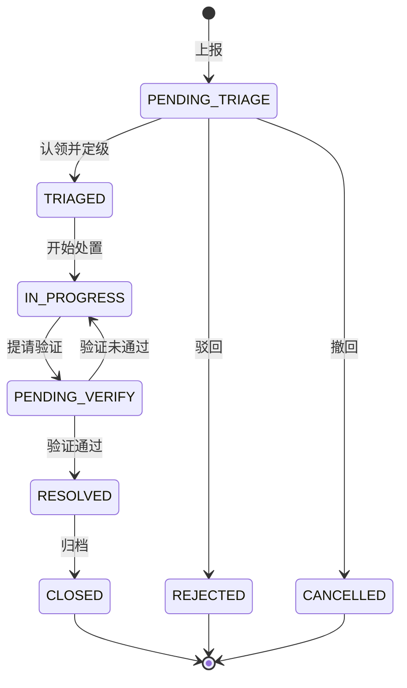

# T12｜事件分级与影响评估助手需求规格

**状态：待实现，供评审与验收。** 本规格说明书定义系统应具备的业务行为与技术约束。当前仓库处于设计阶段，文中的默认值、字段约束与验收标准均为实施基准；各项阈值、字段长度与超时参数按推荐初值设定，可在开发冻结前统一微调。课程要求对照部分仅沿用现有方案中可核验的条款信息。

| 查阅场景 | 对应文档 |
| --- | --- |
| 系统建设目标、业务边界与核心规则 | 本文 |
| HTTP 路由、访问权限、请求参数与错误响应 | [API 契约](API.md) |
| 数据表结构、模块划分、事务边界、查询与运行配置 | [系统设计方案](PLAN.md) |
| 三类业务角色的日常操作与工单交接流程 | [操作手册](WORKFLOW.md) |
| 开发优先级、团队分工与回归测试标准 | [实施计划](IMPLEMENTATION.md)、[验收清单](ACCEPTANCE.md) |

## 1. 背景、目标和交付范围

高校信息中心与企业 IT 运维团队在处置教务、统一认证、财务、门户及网络基础设施故障时，需要清晰掌握受影响资产、当前处理责任人、服务恢复进展以及后续预防同类故障的复盘依据。本系统通过标准化工单串联“申报、分诊、处置、复测、归档”全流程，结合外部大模型与本地规则提供初步定级建议，并由评估师承担最终定级的人工确认责任。

| 建设目标 | 可验证结果 |
| --- | --- |
| 降低故障上报门槛 | 上报人仅需提供标题、故障描述、关联资产和发生时间即可正式提单；上报前预评估可按需跳过。 |
| 避免重复处理与错误转交 | 每张工单仅有一名当前处理人；并发认领、撤回、驳回等互斥操作仅允许一个生效。 |
| 保障应急处置闭环 | 每次状态流转均可追溯至具体操作者；验证未通过可退回重修，验证通过后由管理员复盘归档。 |
| 保障离线与无模型环境可用 | 未配置外部模型凭据或模型异常时，系统自动使用本地规则完成上报、评估、定级及后续处置。 |
| 提供同口径复盘统计数据 | 在固定创建时间窗口与样本集下，管理员可精确复算等级分布、高频故障资产与 AI 定级一致率。 |

本期交付物包括 Java 后端应用、MySQL 数据库脚本、可执行 JAR 包、在线 API 文档及验收证据材料。系统设计涵盖 **3 类角色、7 张数据表、32 个 HTTP 接口、6 个主线状态与 2 个异常终态**。本期范围聚焦人工上报与人工复测闭环；监控告警自动建单、单点登录（SSO）、外部消息推送、文件附件、工单合并或转派、全自动定级、自动执行修复脚本、多租户隔离及独立前端工程均不纳入本期交付。功能演示与验收可通过 Knife4j 或标准 API 客户端完成。

## 2. 术语和角色

| 术语 | 定义与业务说明 |
| --- | --- |
| 事件 ID / 工单号 | 事件 ID 为数据库正整数主键，用于 API 路径定位；工单号全局唯一且对人可读（如 `INC20261120-8K4NR`），用于检索与线下交接。 |
| 资产 | 事件所关联的具体业务系统或基础设施，包含重要度等级（1–5）与响应 SLA。 |
| 发生 / 创建 / 解决时间 | 分别指上报人填写的故障实际开始时间、服务端落库受理时间、原上报人验证通过时间。工单归档时不改写解决时间。 |
| 影响分 / 建议等级 / 最终等级 | 影响分为 AI 或本地规则输出的 0–100 整数；建议等级依据分级规则映射得出；最终等级由评估师认领时人工确认。 |
| 定级快照 | 评估师认领定级时锁定的参考评估 ID、建议等级与影响分；后续触发深度复评不会覆盖该快照，专用于复盘与统计。 |
| SLA | 资产的响应时限与故障等级的解决时限，作为配置项与人工处置参考；本期不基于 SLA 自动触发催办通知、等级升级或状态流转。 |

| 角色 | 事件读取范围 | 允许的事件操作 | 系统配置与基础数据权限 |
| --- | --- | --- | --- |
| 上报人 `REPORTER` | 本人上报的全部事件（含异常终态）、详情与时间轴 | 上报前预评估、正式上报、待分诊状态下补充描述或撤回、待验证状态下确认通过或打回 | 查看已启用资产、分级标准与本人资料 |
| 评估师 `ANALYST` | 未被认领的待分诊事件，以及本人负责处置的事件 | 触发复评、认领并定级、驳回未认领事件；对本人负责的事件开始处置、追加处置记录、提请验证 | 查看已启用资产、分级标准与本人资料 |
| 管理员 `ADMIN` | 全局所有事件、历史评估记录、时间轴与统计报表 | 对处于可复评状态的事件触发复评；对已解决事件执行复盘归档 | 管理用户、资产与分级标准，查看管理审计留痕 |

每个账号仅绑定单一角色。管理员虽具备全局读取权限，但不可越权代执行专属于上报人或当前处理人的业务操作（如代上报人验证、代处理人提请验证）。事件列表在分页前必须先注入当前角色的数据可见范围过滤；单件详情、时间轴与各类写入接口也必须在服务端独立校验归属权，严禁依赖前端隐藏入口或客户端传入的操作者 ID。未认领工单一旦被驳回或撤回，即刻移出评估师的待分诊池，但原上报人与管理员仍可查询。若在途工单的上报人或当前处理人账号被停用或变更角色，由管理员核查是否恢复其账号状态与角色；若无法恢复，工单保持当前状态留待线下跟进，本期不设代验或工单转派入口。

## 3. 账号和主数据

| 编号 | 需求项 | 可验收规则 |
| --- | --- | --- |
| ACC-01 | 注册为上报人 | 用户名去除首尾空白并统一转为小写，全局唯一；公开注册角色固定为 `REPORTER`，拒绝客户端指定角色。密码仅以 BCrypt 哈希摘要落库。 |
| ACC-02 | 登录与身份查询 | 启用状态的账号凭正确密码登录，获取带过期时间的 JWT，并可凭令牌查询本人资料。密码错误、账号不存在或账号已停用统一返回认证失败（`40101`）。 |
| ACC-03 | 修改本人密码 | 仅允许修改当前登录账号的密码，且须校验旧密码。改密成功后此前签发的旧会话立即失效，须用新密码重新登录；任何接口响应均不得包含密码或哈希摘要。 |
| ACC-04 | 查询用户列表 | 仅管理员可访问，支持按用户名（模糊）、角色与启用状态分页筛选，返回字段仅限管理视图所需信息。 |
| ACC-05 | 分配角色与启停账号 | 仅管理员可操作。角色与启用状态变更对后续受保护请求即时生效；账号停用后旧会话立即失效，重新启用后亦需重新登录。每次变更须记录操作人、目标账号、变更前后值与时间。严禁停用或降级系统中最后一名处于启用状态的管理员。 |
| ACC-06 | 校验角色与事件归属 | 除健康检查、注册与登录接口外，其余接口均需认证。已认证但角色不符返回 `40301`，角色匹配但无目标工单归属权返回 `40302`。历史工单的上报人与处理人关联不因账号后续角色变更而自动改写。 |
| MST-01 | 查询业务资产 | 登录用户可按名称/编码关键词、类别与状态分页查询。上报人与评估师仅能查看启用状态的资产；管理员可查看启用与停用资产。关联已停用资产的历史工单仍正常展示资产信息。 |
| MST-02 | 管理业务资产 | 仅管理员可新增、修改或停用资产。资产编码全局唯一且创建后不可修改，名称必填，重要度为 1–5 的整数，响应 SLA 为正整数（分钟）。停用资产仅拦截基于该资产的新工单上报与上报前预评估，存量在途工单仍可正常流转与复评。 |
| MST-03 | 查看分级标准 | 登录用户可读取 `P0`、`P1`、`P2`、`P3` 四档规则（按严重程度由高到低排列），包含闭区间分数范围、等级名称、解决 SLA（正整数小时）及可选的 AI 定级提示说明。 |
| MST-04 | 维护分级标准 | 仅管理员可修改。四档分数区间必须按 `P3` 至 `P0` 连续覆盖 0–100，不允许出现断档或区间重叠。涉及分数边界调整时须一次性提交全部四档，在事务内整体校验并原子保存；规则更新后不重新计算历史评估记录与已锁定的定级快照。 |

推荐初始分级阈值：`P0` 为 85–100、`P1` 为 65–84、`P2` 为 40–64、`P3` 为 0–39。该配置作为数据库种子数据与边界测试基线；实时评估时始终动态读取当前字典配置。

## 4. 工单生命周期

| 编号 | 操作与前置条件 | 成功后的状态流转与持久化记录 |
| --- | --- | --- |
| INC-01 | 上报人提交标题、故障描述、已启用资产，以及不晚于当前服务端时间的故障发生时间。 | 生成唯一工单号并进入 `PENDING_TRIAGE`；工单主记录、首次 AI 评估与初始状态日志在同一事务内提交。响应返回事件 ID、工单号及首次评估结果。 |
| INC-02 | 登录用户分页查询事件列表。 | 先按角色与归属注入数据可见范围，再按工单号、标题、状态、最终等级、资产及创建时间窗口过滤分页。默认按创建时间降序排列，时间相同时按 ID 降序。 |
| INC-03 | 登录用户查询单张工单详情。 | 通过归属校验后，返回标题、描述、关联资产、上报人、当前处理人、状态、发生/创建/解决时间、AI 建议、最终等级及分页评估历史；协作者仅展示业务必需的摘要字段（ID 与显示名）。 |
| INC-04 | 原上报人在 `PENDING_TRIAGE` 状态下补充故障描述。 | 更新描述内容并递增版本号；工单状态、原始时间与已有评估记录保持不变。评估师可基于更新后的描述重新触发复评。 |
| INC-05 | 评估师认领未被认领的 `PENDING_TRIAGE` 工单并确认最终等级。 | 在单次事务内将当前处理人设为操作者，状态推进至 `TRIAGED`，并原子写入最终等级、定级快照、参考评估采纳标记及状态日志。当人工定级与参考评估建议不一致时，必须填写定级理由。 |
| INC-06 | 当前处理人对 `TRIAGED` 工单开始应急处置。 | 状态流转至 `IN_PROGRESS`，并写入状态变更日志。 |
| INC-07 | 当前处理人对 `IN_PROGRESS` 工单提交修复结论、验证方法与预期结果。 | 在同一事务内更新状态为 `PENDING_VERIFY`，同时写入一条 `REPAIR` 类型的处置记录与状态变更日志，供原上报人据以复测。 |
| INC-08 | 原上报人对 `PENDING_VERIFY` 工单提交复测结论。 | 验证通过则流转至 `RESOLVED` 并记录 `resolved_at`；验证未通过必须填写原因，状态退回 `IN_PROGRESS`，`resolved_at` 保持为空，且保留原处理人、最终等级与历史记录，允许处理人修复后再次提请验证。 |
| INC-09 | 评估师对未被认领的 `PENDING_TRIAGE` 工单执行驳回并填写原因。 | 状态流转至异常终态 `REJECTED`，原上报人与管理员可在时间轴中查看驳回原因。 |
| INC-10 | 原上报人撤回本人提交且未被认领的 `PENDING_TRIAGE` 工单并填写原因。 | 状态流转至异常终态 `CANCELLED`，完整保留历史记录与撤回原因。 |
| INC-11 | 管理员对 `RESOLVED` 工单执行复盘归档。 | 状态流转至正常终态 `CLOSED`，可附加复盘备注，已生成的解决时间保持不变。 |
| INC-12 | 状态流转审计与终态约束。 | 每次合法状态变更均须记录原状态、目标状态、操作人、时间戳与备注。`CLOSED`、`REJECTED`、`CANCELLED` 均为终态，禁止重开或物理删除；若故障复发需再次跟进，应新建工单并在描述中引用原工单号。 |
| INC-13 | 防重复提交、并发控制与事务回滚。 | 同一上报人在服务端 UTC 同一自然分钟内、针对同一资产提交去首尾空白后相同的标题时，第二次请求予以拒绝（`40902`），且不产生多余的评估或日志；跨自然分钟不视为重复提交。同一版本号上的并发互斥操作仅允许一个成功。业务数据写入与状态日志写入任一失败，整次操作必须完整回滚。 |

工单在进入 `TRIAGED` 时首次绑定当前处理人与人工最终等级；在进入 `RESOLVED` 时首次生成解决时间；完整走通一次正常主线（无打回）共产生 6 条状态变更日志（含初始建单）。任何未在状态图中列出的跳转均属非法流转（`40901`）。系统不设自动认领、自动验证通过或超时自动归档机制。

## 5. AI 评估、处置记录和时间轴

| 编号 | 功能模块 | 可验收规则 |
| --- | --- | --- |
| ASM-01 | 上报前预评估 | 上报人可输入拟提交的标题、故障描述与已启用资产获取定级建议预览；该操作不落库，不生成事件、评估记录或状态日志。 |
| ASM-02 | 正式上报首次评估 | 正式建单时必须独立生成并落库首次评估记录，不可复用此前的预览结果。工单主表上的初始 AI 建议等级与影响分同步自该首次评估。 |
| ASM-03 | 在途工单深度复评 | 管理员可对处于 `PENDING_TRIAGE`、`TRIAGED`、`IN_PROGRESS`、`PENDING_VERIFY` 的工单触发复评；评估师触发复评时，目标工单还须满足“待分诊未认领”或“由本人负责”。复评仅追加评估历史，不修改工单状态、已确认的最终等级或处置记录。 |
| ASM-04 | 双引擎驱动与输出规范 | 外部模型成功返回合规结果时标记为 `LLM_API`；未配置模型、调用失败、超时、JSON 结构不合规或分值与等级区间矛盾时，自动切换至基于关键词与资产重要度的本地规则引擎，并标记为 `RULE_FALLBACK`。两类引擎均输出建议等级、0–100 整数影响分、影响范围、初步根因推测、处置建议及评估耗时；线索不足时相应文本标记为“待确认”。 |
| ASM-05 | 定级依据与人工覆盖 | 评估师认领定级时可指定本单已有的任一评估记录作为参考，未指定时默认引用首次评估。仅当所引用的评估建议等级与人工最终等级一致时，才将该评估记录标记为已采纳（`is_adopted = 1`）；人工调整等级时必须填写定级理由。认领时锁定的参考评估 ID 与建议快照不因后续复评而改写。 |
| ACT-01 | 追加应急处置记录 | 仅当前处理人可对处于 `IN_PROGRESS` 的工单追加处置记录，操作类型支持排查（`DIAGNOSE`）、止损（`MITIGATE`）、修复（`REPAIR`）与通报（`NOTIFY`）。记录包含操作详情、可选的非负耗时（分钟）、操作人与时间，不改变工单状态与版本号。 |
| ACT-02 | 查询完整时间轴 | 按工单可见性范围统一读取状态变更日志与处置记录，按创建时间升序排列（时间相同时顺序固定且可复现）。时间轴清晰区分两类条目，完整展示验证打回、撤回、驳回等原因；AI 评估历史则在工单详情中独立分页展示。 |

AI 评估结果仅作为人工定级的辅助决策依据。即使未配置外部模型 API，系统也必须返回结构完整、可直接用于流转的本地规则评估结果。调用获准配置的外部模型时，仅允许发送经清理的故障标题、故障描述、资产类别/重要度及分级标准说明；严禁外发用户账号、手机号、密钥凭据或内部鉴权信息。若检测到文本中含有无法可靠脱敏的敏感内容，应直接降级为本地规则评估。模型输出的根因与建议须明确作为推测信息呈现，系统绝不据此自动推进工单状态或自动执行外部运维指令。

## 6. 复盘与报表

| 编号 | 报表名称与统计范围 | 计算口径与规则 |
| --- | --- | --- |
| RPT-01 | 通用访问与时间窗约束 | 仅管理员可查询。支持传入可选的创建时间窗口，采用左闭右开区间（`createdFrom ≤ created_at < createdTo`）；起止时间须同时提供或同时省略。所有报表基于过滤后的同一工单集合并按统一时区解析，窗口内的工单按查询时刻的当前状态参与统计。 |
| RPT-02 | 等级分布统计 | 仅统计已确认 `final_severity` 的工单，按“最终等级 + 当前状态”分组聚合，返回各组工单数量及定级快照中影响分的算术平均值。 |
| RPT-03 | 高风险资产 Top 5 | 统计除 `REJECTED`、`CANCELLED` 之外的所有有效工单，按关联故障数量降序、资产 ID 升序排列并取前 5 项。每项资产的平均恢复耗时仅基于已处于 `RESOLVED` 或 `CLOSED` 且起止时间有效的样本计算（`resolved_at - occurred_at`）；未解决工单不计入耗时分母，更不得按 0 秒折算。 |
| RPT-04 | AI 定级一致率与耗时 | 定级一致率以“已确认人工最终等级的工单总数”为分母，以“人工最终等级与定级快照建议等级一致的工单数”为分子（表示为 0–1 之间的小数，分母为 0 时返回 `null`）。同时独立统计该工单集合下所有已落库评估记录（含未定级工单的评估，不含上报前预览）的总次数与平均耗时。 |

当查询区间内无匹配分组或资产样本时，列表型报表返回空数组 `[]`；当无有效恢复耗时或评估样本时，对应的均值或比率字段返回 `null`，计数类字段返回 `0`。对历史工单再次触发复评，仅会增加评估总次数并影响平均评估耗时，不会改变历史等级分布或 AI 定级一致率。

## 7. 非功能要求

| 编号 | 主题 | 可验收标准 |
| --- | --- | --- |
| NFR-01 | 身份认证与数据安全 | 严格校验 JWT 签名与有效期，每次受保护请求均实时核对账号启用状态、角色及令牌版本；敏感凭据仅通过环境变量或部署配置注入。生产环境关闭在线 API 调试页面，且在任何响应、文件与日志中均不得输出明文密码、密码哈希、完整 JWT、API 密钥或外部模型的原始请求/响应报文。 |
| NFR-02 | 数据完整性与并发控制 | 依托数据库外键、唯一索引与基于版本号的条件更新保障数据一致性；任何失败或冲突的请求均不得残留孤立的评估记录或状态日志。时间参数按明确时区解析，服务端内部统一以 UTC 存储与计算，对外 API 统一输出标准 UTC ISO 8601 时间。 |
| NFR-03 | 错误处理与可观测性 | HTTP 状态码、业务错误码与可读提示信息保持一致映射，每次响应附带 `requestId` 以便客户端与运维排查排障。健康检查接口仅反映应用与数据库的整体连通状态；服务端日志清晰区分认证鉴权失败、并发/状态冲突、模型降级与系统未知异常，并落实敏感字段脱敏。 |
| NFR-04 | 查询性能与外部调用隔离 | 所有列表与评估历史查询均强制执行分页上限；过滤、聚合统计与分页均在数据库侧完成，工单详情与时间轴查询严禁逐条回表引发 N+1 问题。外部模型调用必须配置连接与读取超时，且严格置于数据库写事务之外。鉴于当前未约定固定压测指标，验收时须如实记录测试环境、样本规模与实测表现。 |
| NFR-05 | 可复现构建与独立交付 | 基于 Java 21、Maven 与 MySQL 8.0 构建，`dev`/`prod` 环境配置分离。从干净代码检出后可直接通过 `mvn clean verify` 完成构建并启动可执行 JAR。离线验收指无需连接外部大模型服务即可走通完整业务，但仍需连接可用的 MySQL 数据库。 |

## 8. 交付、验收与待确认项

| 阶段优先级 | 核心交付范围 | 阶段通过标准 |
| --- | --- | --- |
| 1. 首个里程碑 | 最小化账号、资产与分级规则种子数据；不依赖外部模型的工单主线流转 | 从空库导入建表与种子脚本，三类角色成功登录，一张工单完整走通 `PENDING_TRIAGE` 至 `CLOSED`，数据库中准确生成首次评估与 6 条状态变更日志。 |
| 2. 功能完整交付 | 全部 32 个 HTTP 接口、所有异常分支、深度复评、模型降级、时间轴与三大统计报表 | 角色权限隔离、水平越权拦截、并发抢单、事务回滚及报表数据均可精确复算，并按[验收清单](ACCEPTANCE.md)留存测试证据。 |
| 3. 最终打包交付 | 可执行 JAR、数据库脚本、演示数据、环境变量示例、Knife4j 文档、设计文档集、验收记录与三人贡献表 | 未参与开发的人员仅凭仓库文档即可在独立空库环境下启动服务、登录账号并完整复现核心验收用例。 |

待确认事项：生产环境的目标数据规模与性能指标、外部大模型供应商选型及数据出境/外发合规审批、生产部署宿主平台与数据库备份策略。本期实施以“隔离 MySQL 数据库 + 无外部模型凭据”作为强制必测基线，不将尚未明确的外部生产环境指标作为当前交付承诺。
